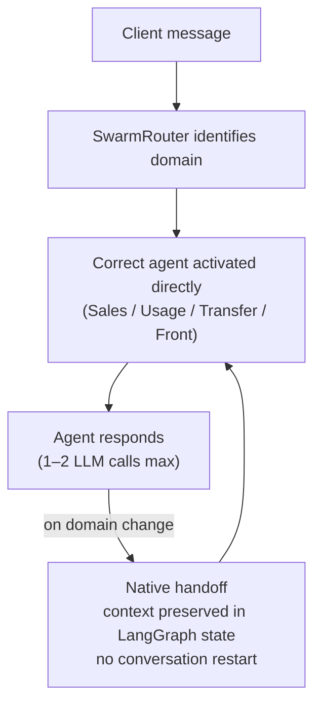

# Projects

Four systems I've designed and shipped to production, all currently running at Boulanger, one of France's largest electronics retailers. Each is written up the way I'd want to read it: what was at stake, the decisions that mattered — including the things I said no to — and what actually changed.

## Customer AI assistant — web & mobile

LangGraphKubernetesAzure OpenAIFastAPI

### The stakes

Boulanger's customer chat ran on a static decision tree (Dialogflow) — the kind of bot customers learn to route around. The bet: replace it with a generative assistant good enough to become a real customer channel, on the website and mobile app, for the *entire* journey — product advice, order tracking, after-sales, human escalation. I led it end to end — architecture, development, Kubernetes deployment, API exposure, security, response quality, and the business relationship. Other engineers contributed along the way; every structural choice on this page was mine. The company's Kubernetes cluster and API gateway already existed — everything above them was built from scratch. Six months from first commit to production, live since October 2025 — and succeeded in October 2026 by its second generation, [the shopping agent](#second-generation-from-a-chatbot-to-a-program).

~2,000<small>conversations / day</small>
73–75%<small>resolved without escalation</small>
78%<small>satisfaction · 10,450 ratings</small>
~2.4s<small>average latency</small>

### The decision that shaped everything: no orchestrator

A naive multi-agent system routes every message through a central orchestrator that calls an LLM just to decide who handles it, then calls the agent, then formats the output — every hop adds latency and cost. I designed the swarm so routing and handoffs are native to the graph itself:

No external classifier, no orchestration layer, minimal LLM calls per message by construction. The ~2.4s average latency is what one model call plus tools plus formatting costs — the architecture's job is to never add a superfluous call on top of it.

!!! tip "More on this"
    I wrote up the general principle in [Latency is an architecture problem, not a prompt problem](writing/2026-08-14-latency-is-an-architecture-problem.md).

### The other decisions that mattered

- **Fully async, end to end** — FastAPI + Motor (async MongoDB) + httpx, so no request blocks a worker during an LLM call, a DB write, or an internal API request. Kubernetes ReplicaSets and resource limits sized against real concurrent load.
- **Security inside the graph, not bolted on** — prompt-injection detection and off-scope filtering at the router, before any agent runs; strict per-agent tool isolation so an agent can only call what it owns.
- **Structured output for anything factual** — typed, validated responses for product identifiers, with offers separated from prose. Removes an entire class of hallucination on things that must be exact.
- **Native interrupt/resume for escalation** — when a conversation needs a human, the graph pauses, the customer picks a channel (live chat or scheduled callback), and the conversation resumes from the exact same state. No context loss, no starting over.
- **Prompts as versioned Markdown, not embedded strings** — a prompt change is a merge and a redeploy, not a code change. Quality is tracked continuously with **Langfuse** LLM-judge scoring against production traffic.
- **The API contract was negotiated, not decreed** — 12 polymorphic content types (text, product carousels, link cards, escalation actions, end-of-conversation states) co-designed across many workshops with the web, iOS, and Android teams. Each client declares what it can render; the assistant adapts. This was the longest part of the project, and the reason all three channels render the same conversation correctly.

### What broke in production

The most instructive bug: product carousels always rendered *after* all the text, whatever order the model intended — a timing misalignment between LangGraph's two streaming channels (`messages` vs `custom`). The lenient JSON parsing that works for live text produces false positives on structured blocks, so the fix was a character-by-character scanner over the raw stream that detects each block's *actual* closure. It shipped with 44 new tests. Bugs like this are why streaming is treated here as a product surface, not a transport detail — and why quality regressions are watched continuously, not discovered by customers.

### What it changed

The assistant covers the entire customer journey — 26% after-sales, 22% pre-purchase advice, 17% order management, the rest across FAQ, delivery, billing, and loyalty. The honest read on the ~25% escalation rate: a large share is *structural* — order cancellations and modifications that no system could self-serve because the internal API doesn't exist yet (it's in development). The assistant diagnoses those correctly and routes them to the right human.

The larger outcome is organizational. **In twelve months, the chat went from an isolated AI project to a company reflex: every new IT project at Boulanger now ships a chat facet as a baseline requirement** — order selfcare and retail media integrations are arriving in the channel next. That's the difference between delivering a system and creating a channel, and it's become the reference pattern for every new AI touchpoint at the company.

### Second generation: from a chatbot to a program

By 2026 the assistant had outgrown its first platform. Its successor — the **shopping agent** — is a program, not a release: a sales assistant built to reproduce in-store expertise and speed up purchase decisions, a guided after-sales journey for reporting a breakdown, a product-care assistant for setup and maintenance, and the migration of the whole platform to the company's standard Kubernetes stack. All of it ran in parallel, and collided with other company projects along the way. I was named the program's AI product lead, and I lead its engineering team of five — including a senior DevOps engineer with twenty years of experience, whom I recruited.

5<small>engineers led</small>
32<small>production tools</small>
912<small>automated tests</small>
328<small>red-team cases on guardrails</small>

**The hardest call: one platform, not three.** The after-sales and product-care journeys had their own front-end and IT teams, under no obligation to adopt the new API. I pushed them onto it anyway, on the strength of the API contract and interface built for the shopping agent. The result is a single assistant for sales and after-sales instead of three integrations to maintain — and all three journeys reached production on the website within the same week.

**What I said no to before launch:**

- **No to moving prompt management into Langfuse for the first release.** Governance and the right architecture in the code had to come first. It shipped after launch: prompts are now versioned there, with a fallback on disk and CI synchronization.
- **No to letting business teams edit prompts yet.** They can test a candidate prompt against real traffic; they can't ship one. Opening that before evaluation and governance exist is how a production assistant drifts silently.
- **No to deployment rights for everyone.** With coding assistants, anyone can change anything — with nobody checking behind. Deployment stayed restricted, and I handed out production responsibility feature by feature, as each engineer proved ready: the first releases they owned end to end went live in the launch weeks.

**Launch.** Behind a feature flag: 25% of boulanger.com traffic on 21 October 2026, a 50/50 A/B test a week later, then the iOS and Android apps from 3 November — with the first generation kept running for a month as a fallback. A memory leak surfaced on day two; it was diagnosed and fixed the same day.

---

## Self-BI — natural language over Snowflake

MCPGemini EnterpriseSnowflakePower BI

### The stakes

Business teams — finance, digital, commerce, retail stores — needed answers from the data warehouse without waiting on a data analyst. Every path to that runs through an uncomfortable trade-off between access and control, and while other approaches were still being debated, I took this one from proof of concept to production. This project is mostly a story about which options I turned down — and about earning trust in the numbers.

### What I said no to

**No to Snowflake's native self-service BI.** Too costly to roll out at company scale, and it assumes every user has a Snowflake account — most don't and never will.

**No to OAuth with users' personal credentials.** Personal accounts inherit privileges far broader than anything an AI agent should be able to exercise, and again — most target users have no account at all. Instead: one dedicated service account per use case, bound to a **read-only Snowflake role scoped to exactly that use case's data**.

**No to an orchestrator on top of Snowflake's own text-to-SQL layer.** Two model layers means double the cost and double the latency, for no gain in accuracy.

### What I built instead

An in-house **MCP server** per business scope, consumed by one agent per use case on **Gemini Enterprise** — the interface these teams already use daily, through its native MCP connector. No new tool to learn, no Snowflake account required, no training rollout. Two scopes are in production: customer analytics and the smartphone category.

!!! note "Security is four independent layers, so no single failure exposes data"
    1. Identity checked at the edge — a relay validates the user's token before anything else runs
    2. Re-validated at the API gateway — no valid token, no access to the MCP server at all
    3. Deny-by-default statement enforcement — only read statements ever reach Snowflake, parsed and verified, not trusted
    4. A read-only Snowflake role per scope, limited to dedicated views — even a hallucinated query against the wrong table is rejected by the database itself

The design was validated by the security team and IT architects. This is what "assume the model will be wrong" looks like in practice: the agent can hallucinate all it wants; the blast radius is a rejected query.

### The hard part nobody plans for: trusting the numbers

A finance team drops an analytics agent the first time it disagrees with their dashboard. So the agent's business knowledge isn't written by hand: it's **extracted from the existing Power BI models** (178 measures for customer analytics, 542 for smartphones), translated into SQL rules, **reconciled against the reference dashboard** — within 0.01% on customer analytics, identical to the cent on smartphones — and versioned so it can be updated in production without a release.

Every other choice was measured the same way:

- **Model selection by blind comparison** — over 61 conversation turns, the retained model got 51 fully right, against 27 for the alternative.
- **Specialized tools for frequent questions** — 21 tools, each running a validated SQL template: median answer time down from 150 to 60 seconds, with zero discrepancies across 46 test cases and 8,795 cells.
- **A repeatable onboarding method** — the first scope took about two weeks; the second, about three days.

### What it changed

The finance performance teams use it every Monday for their weekly KPI review, and it supports product leadership meetings. One user's verdict: *"If I'd had it in June, I'd have saved two weeks of work preparing next year's targets."* It runs on licences the company already paid for.

The bigger outcome was settling who owns what. Data and semantics belong to the data team, which is building the data products the platform plugs into; the platform and the tools belong to the AI team. That split — rather than a winner — is now the company's target architecture.

---

## Vox — voice AI for the customer-service line

LangGraphClaude on Vertex AISSE streamingHexagonal architecture

### The stakes

Bringing generative AI to Boulanger's customer-service phone line, replacing a keypad menu with a conversation. An external partner handles telephony, speech-to-text, and text-to-speech; Vox is the conversational API behind it. It receives the caller's transcribed words, streams its answer so speech starts immediately, queries the company's systems, and decides whether to continue, close the call, or hand over to an agent.

I was involved eight months before the build — vendor discussions, the tender, the final selection committee — and co-designed the architecture that came out of it: **the vendor is a voice gateway; the business logic and access to company systems stay in an in-house agent**, for security and data sovereignty. I lead it end to end — architecture, code, prompts, integrations, authentication, observability, production analysis, and the relationship with the vendor and the customer-service teams — and manage one developer on it.

100%<small>of service calls in 3 days</small>
56,000+<small>calls in the first 6 days</small>
~17,900<small>calls / day at peak</small>
~450ms<small>to first token</small>

### Launch: 25% → 50% → 100% in three days

Vox went live on 28 October 2026. The progressive ramp-up was my recommendation, and at the go/no-go I argued for an even more cautious start than planned. The scope grew at launch: designed to handle only requests that need company systems, Vox ended up taking the whole conversation, FAQ included, with the partner's own flow kept as the fallback. It absorbed a peak of 2,361 calls in one hour on five small pods — the cost is in the model, not the compute.

### On a phone call, latency is silence

On the web, latency is a metric. On the phone, the text-to-speech engine has to start speaking before the model has finished generating. That single constraint reshaped every layer:

| | Web assistant | Vox |
|---|---|---|
| Control decisions | LLM classification | **Deterministic — no LLM call decides to end or transfer** |
| Response length | Long, detailed | **Short phrases built for speech**, one piece of information at a time |
| Streaming | Optional | **Token-by-token SSE**, so speech starts immediately |
| Architecture | Layered | **Hexagonal** (ports & adapters) |

- **Prompt caching and keep-warm** — the system prompt is static to the byte so it can serve as a cache prefix (≈80% cheaper input), and each pod keeps the model connection warm, since an idle connection otherwise adds half a second to a second. Warm time to first token: ~450 ms.
- **Model migration measured, not assumed** — moving to a newer generation of the model cut cost per turn by about 8.5×, with 30% shorter turns. Extended reasoning stayed off after I caught it leaking into the spoken text.
- **No dead air** — a short holding phrase ("Let me check…") before every lookup.

### The model names, the code decides

Everything that must be reliable lives in code, not in the prompt. The model says which appliance is broken; the code decides between a store drop-off and an agent. Once a transfer is requested, it stays requested. No one-time code is sent to an unknown caller. Location is verified before any store-pickup search.

Caller identification follows the same principle, adapted to the phone: a one-time code by SMS or email, then a control question — the city of an address on the account, matched phonetically to survive transcription errors. 73% of callers who receive a code are identified successfully.

### What broke in production — and how I found it

Telling the AI's failures apart from the voice platform's took real analysis, not dashboards: aligning the vendor's transcripts with our API traces to the millisecond, stratified sampling, weighted estimates with confidence intervals, and LLM-assisted labeling. The first day's 4,061 calls led to **five corrective releases in 48 hours**:

- **Callers who interrupted lost their whole turn.** Root cause: request cancellation killed the checkpoint write. Fixed with asynchronous checkpointing, a clean cut at the interruption point, and a per-conversation lock across pods.
- **60% of callers phone from a number that isn't linked to their account**, and code dictation failed two times out of three. They're now detected upstream and routed straight to an agent: **abandonment fell from 11.6% to 6–7.5%**.
- **25 callers were never transferred on day one** — the platform sent one more turn after the transfer decision. A deterministic guard now holds every transfer.
- Issues on the vendor's side became **12 quantified, prioritized requests** instead of arguments.

### What it changed

- **8% of calls resolved with no agent** over the first six days, across all reasons — four times the 2% assumed at scoping — and **29% on product questions**.
- **81% of transferred calls** reach an agent with an identified reason. Asking the caller where they bought raised the known purchase channel from 9% to 70% of order transfers, so calls land in the right queue.

This is what a second system looks like when the first one taught you where the bodies are buried.

---

## Internal agents — Google Chat & Gemini Enterprise

Cloud RunGemini EnterpriseGoogle Chat

### The stakes

Customer-facing AI was live; the company's own employees had none. This channel targets people who use neither the customer site nor Gemini Enterprise: **Google Chat**, the internal messaging tool everyone already has open. The thesis — every surface the company already uses becomes an entry point for agents — is the same pattern each time: a business-owned agent, grounded in official sources, on a surface with zero adoption cost.

### What I built

A Cloud Run service that links Google Chat spaces and conversation sessions to agents running in Gemini Enterprise. Employees talk to the agents in the chat tool they already use; nothing to install, nothing to learn.

### The operating model is the interesting part

The first agent on the channel was the **company's official HR assistant**, built in direct collaboration with the HR team — and they are its product owner in the full sense: they own the content, the scope, and response validation. It answers routine HR questions around the clock, grounded exclusively in official HR documentation, and it works because the people accountable for HR answers control what the agent is allowed to say.

In November 2026 the channel opened to **every employee nationwide**, announced by HR and Finance leadership: four agents, including the HR assistant and an internal-procedures assistant.

### From project to platform

The first version ran on an agent and a retrieval layer I built for each use case. The current one inverts the model: business teams design and own their agents themselves in Gemini Enterprise, and the AI team's job is distribution — putting them in front of the whole company. That's the quiet goal of all four projects on this page: each one starts as a delivery and ends as a capability the organization can repeat without me.
