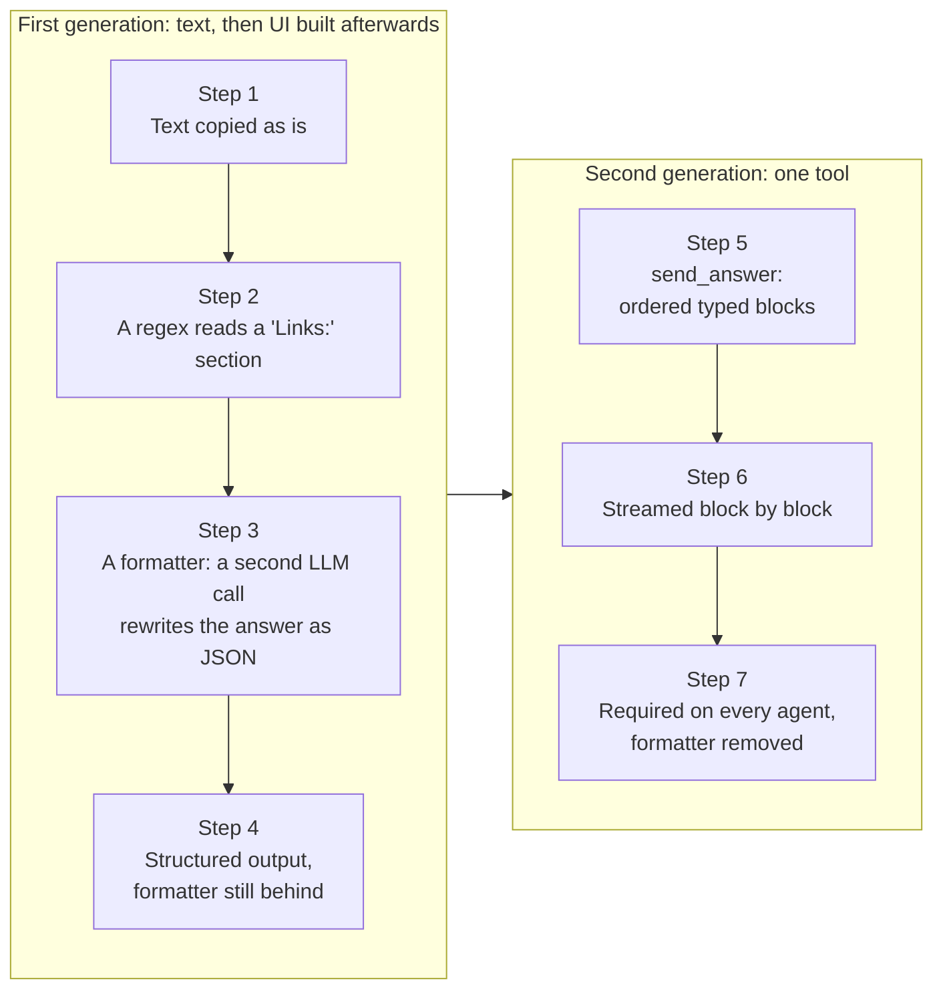
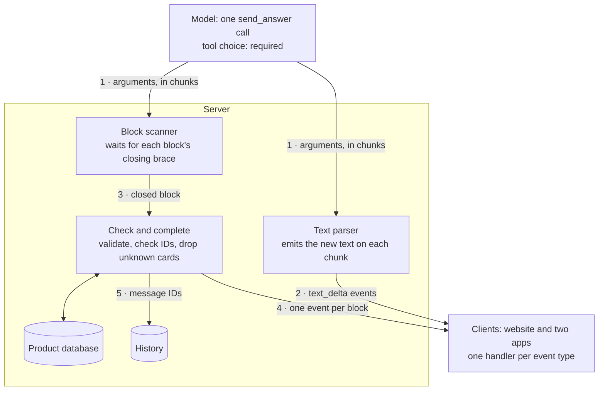
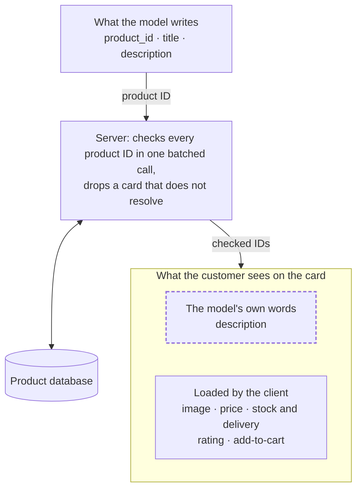
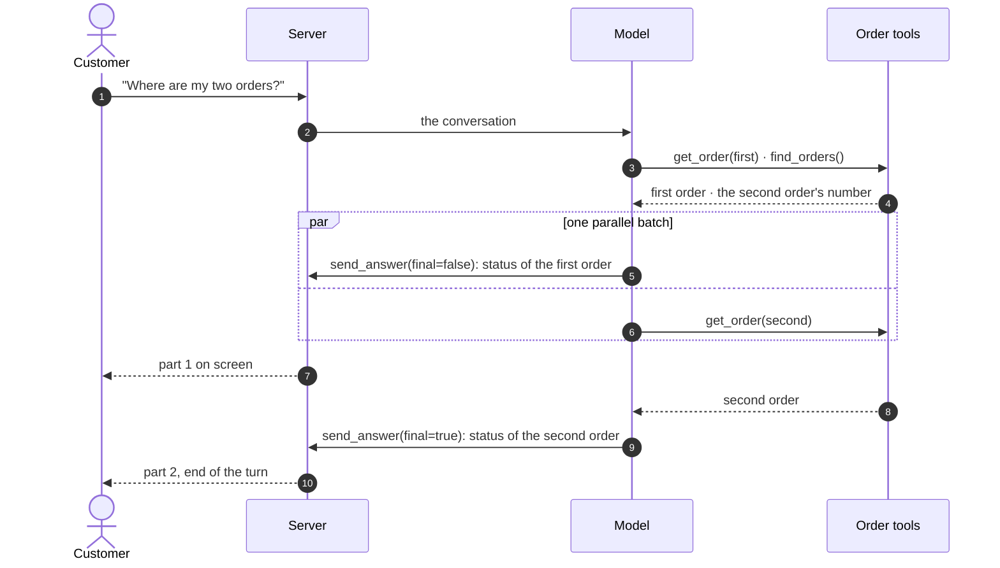

A chat agent that serves customers has to send more than text: product cards, buttons that open the right page, replies to tap, all rendered by front ends it does not own. Booking assistants, banking apps, and internal copilots face the same problem. One answer is to never let the model write free text. Here, it calls one tool, `send_answer`, and fills typed blocks from a closed catalogue, which the server checks, completes, and streams as typed events to a website and two mobile apps built by other teams. This article gives you that protocol, the options I ruled out, and what the design costs, measured on production traffic and in a replay experiment.

## Three clients render the answers, and none of them is mine

Here is one answer, in the shape the model writes it. It recommends a TV.

!!! note "Illustrative examples"
    The answers, field names, code, and events in this article are illustrative. They keep the shape of the real system, with simplified names and made-up products. The measurements are real.

``` { .js title="send_answer arguments, one answer" .annotate }
{
  "blocks": [
    {"type": "text",
     "text": "The cheapest 55-inch TV with a 120 Hz panel is the Model A, at $549. It handles sports and console games well, but its sound is basic: plan for a soundbar if you watch films. The Model B costs $499, but its panel runs at 60 Hz."},
    {"type": "products",
     "title": "The cheapest 55-inch TV at 120 Hz",
     "items": [
       // (1)!
       {"product_id": "tv-0001",
        "title": "Model A 55-inch 4K TV",
        // (2)!
        "description": "The lowest price for a 120 Hz panel at this size. A good fit for sports and console games."}
     ]},
    {"type": "text",
     "text": "If fluid motion matters most, go for the Model A. Shall I add it to your cart?"},
    // (3)!
    {"type": "suggestions",
     "options": ["I'll take the Model A", "Show me the Model B", "I'd rather have better sound"]}
  ]
}
```

1.  A reference, not data. The image, the price, and the stock are not in the call: the client loads them from this ID.
2.  The only field on a product card written in the model's own words.
3.  Suggestions: three replies the customer can tap instead of typing.

On screen, the customer sees two paragraphs, a product card with its image, price, and stock, and three suggestions to tap.

I use four words in the rest of this article.

!!! term "Block"
    One typed element of an answer. This answer has two text blocks, a products block, and a suggestions block. A text block is still prose written by the model. What the model never does is answer outside the tool.

!!! term "Catalogue"
    The closed list of block types the model may use.

!!! term "Client"
    An application that renders blocks: the website or one of the two mobile apps.

!!! term "Turn"
    Everything between a trigger, usually a customer message, and the end of the answer.

The agent is a multi-agent system: several specialized agents share the work, each on one part of a retail customer's needs, such as finding a product, following an order, getting help with a product, or reaching a human. It handles thousands of conversations a day. Other teams build the three clients, each on its own release schedule. A design team drew the components the agent can show, as a library: product cards, carousels, buttons, suggestions, surveys.

That gave me four constraints:

<div class="grid cards" markdown>

-   :lucide-smartphone: __Native clients__

    ---

    No client renders HTML written by a model. Every component comes from the design system, and two of the three clients are native apps.

-   :lucide-shield-alert: __Nothing made up__

    ---

    A made-up link, phone number, or product has a real cost in a retail chat.

-   :lucide-file-lock: __One stable contract__

    ---

    One API contract serves three clients that ship on different schedules, so it has to stay stable while the model and the prompts change.

-   :lucide-timer: __Several seconds per turn__

    ---

    The agent calls tools before it answers. The chat has to show something during that time.

</div>

## In the early versions, the model wrote text and we rebuilt the UI afterwards



The first generation of the agent ran on a 2024 multimodal GPT model, with a 128,000-token context window and no built-in reasoning, and without streaming. The model wrote free text, and we turned that text into UI after the fact. At first we copied the text as is and attached links and products taken from the tool results. Then the prompt asked the model to end with a "Links:" section, and a regular expression extracted the URLs, which worked as long as the model kept the format.

Next we added a second LLM call after every answer, the formatter. It rewrote the agent's text as JSON with three fields (the answer, the links, the product references), and code assembled three kinds of blocks from it. The formatter worked, and it stayed in production for a long time.

Its costs grew with the product:

- **Two LLM calls per answer.** A load audit of that generation measured median request times of 6 to 10 seconds, formatter included.
- **Product IDs recovered from prose.** We kept adding validators, after the formatter once took a phone number for a product reference.
- **The agent's wording rewritten** by a second model.
- **No streaming.** An answer that only exists after a second call cannot be streamed.

We then moved agent by agent to structured output, with the formatter still running behind.

The change started in a small part of the system. A smaller assistant in another part of the system needed suggestions, and we gave it a tool to send its answer: a text and a list of suggestions, with the tool call required. That tool is the direct ancestor of `send_answer`.

Around the same time, the business decided to give the agent a real place on the site and in the apps, with a new design. I owned the architecture and the API contract with the client teams. I generalized that tool: `send_answer` replaced the final JSON for every agent, with an ordered list of blocks. Streaming followed within days. A few months later the tool call became required on every agent, and we removed the formatter that same week.

Answering through a tool did not fix everything. It costs tokens, it depends on a provider feature, and some malformed calls still get through.

## No existing option fit native clients

Answering through a tool is an old pattern: [ReAct had a `Finish[answer]` action in 2022](https://arxiv.org/abs/2210.03629), [Pydantic AI returns structured output through a tool by default](https://github.com/pydantic/pydantic-ai/blob/main/docs/output.md), and [LangChain has `ToolStrategy`](https://docs.langchain.com/oss/python/langchain/structured-output). What I had to choose was how the answer reaches a screen.

[CopilotKit's guide to generative UI](https://www.copilotkit.ai/blog/the-developer-s-guide-to-generative-ui-in-2026) sorts the options into three kinds: static (the front end owns the components, and the agent picks one and fills it), declarative (the agent sends a UI specification), and open-ended (the agent sends HTML). With a design system and native clients, I needed the static kind.

The options differ on three questions: who chooses the UI, what goes over the wire, and who renders it. The last column is my own judgment for our case: native clients, built by other teams.

| Approach | Who chooses the UI | What goes over the wire | Who renders it | Fit for our case |
| --- | --- | --- | --- | --- |
| Vercel AI SDK | The model, by calling a tool | A message stream with partial tool input | React, Vue, or Svelte hooks, which parse the partial JSON in the browser | Weak |
| CopilotKit with AG-UI | The model, by calling a tool | About 30 typed events, including raw tool-call arguments | React and React Native hooks | Medium |
| Google A2UI | The model or agent code, from a negotiated catalogue | A tree of components plus a data model | Native renderers (web, Flutter; SwiftUI and Compose in alpha) | Strong, but very new |
| MCP Apps, OpenAI Apps SDK, ChatKit | The server author (HTML templates or widgets) | HTML in a sandboxed iframe, or a widget tree | The host application, or a web SDK | Weak |
| LangGraph generative UI | Graph code | A component name and props | React bundles served by the platform | Weak |
| Free text with inline tags | The model, in its prose | Markdown with custom links or tags | Each client, after parsing the Markdown | Medium |
| Adaptive Cards, Rasa, Dialogflow | The bot developer | A typed card | Native renderers | Strong, but built for cards a developer writes |
| **What I built** | The model, from a closed catalogue | Text deltas, and one typed event per block | Each client, with its own components | |

Why I ruled each one out, and what refusing it costs:

=== "Client-side parsing"

    Client-side parsing is what the [Vercel AI SDK](https://ai-sdk.dev/docs/ai-sdk-ui/stream-protocol) and CopilotKit do: the client receives the tool arguments as they stream and parses them. That assumes a JavaScript client. Ours are two native mobile apps and a web micro-frontend owned by another team, which would mean the same partial-JSON parser written three times by teams that don't own the schema.

    **The cost of refusing it:** I maintain that parser on the server.

=== "HTML and iframes"

    HTML written by the model, or served in an iframe as in [MCP Apps](https://modelcontextprotocol.io/seps/1865-mcp-apps-interactive-user-interfaces-for-mcp) and the OpenAI Apps SDK, does not fit native apps with their own design system.

    **The cost of refusing it:** rigidity. The model can never show something the catalogue lacks, and a new component means a contract change and three client releases.

=== "LangGraph UI"

    [LangGraph's generative UI](https://docs.langchain.com/langsmith/generative-ui-react) was the closest to our stack, since the agents run on LangGraph. It sends a component name and props, and loads React bundles from the platform. That works on the web only.

=== "Inline tags"

    Free text with inline tags, like [the `card:` links Shopify's Sidekick puts in Markdown](https://shopify.engineering/sidekicks-improved-streaming), is simpler to stream, and the text keeps its natural flow. But nothing validates a tag against a schema before it reaches the screen, and each client has to parse a Markdown extension. Free text followed by a second call that structures it is the option our early versions ran.

=== "A2UI"

    [A2UI](https://a2ui.org/concepts/catalogs/) is the closest standard to what I built. Its authors' own rule is to use it when one agent serves more than one platform, which is our case. It [reached 1.0 in November 2026](https://developers.googleblog.com/a2ui-10-build-delightful-fast-reliable-agentic-experiences/), after we were in production, with SDKs and native renderers still in 0.x.

    **What would change my mind:** stable native renderers.

=== "Adaptive Cards"

    [Adaptive Cards](https://learn.microsoft.com/adaptive-cards/resources/principles) and the bot platforms from before LLMs are the model I followed: typed cards that each host renders natively. Here the model picks the cards.

The primitives for the rest exist. Every provider streams tool-call arguments, and Pydantic AI can stream a partially validated output. What I did not find was the layer on top: deciding when each block of a list is complete, and turning it into a typed event for clients that never see JSON. On the LangChain forum, [the answer about streaming partial structured output from the backend](https://forum.langchain.com/t/is-it-possible-to-stream-structured-output/2179) is that it is not supported, by design.

## The model answers by calling one tool



Read the figure from top to bottom. The model streams the arguments of one tool call (1). Two parsers on the server read the same chunks. One sends text as it grows (2). The other waits for each remaining block to close (3), then the server checks the block, completes it, and sends it as one event (4). The stored answer keeps the message IDs the clients received (5).

The model's only way to answer is this tool:

```python
send_answer(blocks: list[Block], final: bool = True)
```

Every agent's model is bound with `#!python tool_choice="required"`, so every model call is a tool call. A turn ends with a `send_answer` call, or with one of two designed ending tools (handing over to a human, closing a support flow), which send their own message.

## The catalogue is closed, and each agent gets a subset

The blocks are Pydantic models. The rules for each block live in the tool's description, versioned with the code. When a block misbehaves, I have one file to open: the rule and the schema sit together.

=== "Schema"

    Some of the blocks, simplified:

    ``` { .python title="blocks.py (illustrative)" .annotate }
    class TextBlock(BaseModel):
        type: Literal["text"] = "text"
        text: str = Field(description="Text shown to the customer. No link or URL.")


    class ProductItem(BaseModel):
        # (1)!
        product_id: str
        title: Optional[str] = None
        # (2)!
        description: str = Field(description="Why this product fits the request, 1-2 sentences, no URL.")


    class ProductsBlock(BaseModel):
        type: Literal["products"] = "products"
        title: Optional[str] = None
        items: List[ProductItem] = Field(description="1 item: a card. 2 or more: a ranked carousel.")


    class Button(BaseModel):
        label: str = Field(description="Button label, e.g. 'See my orders'")
        # (3)!
        destination: Page


    class ButtonsBlock(BaseModel):
        type: Literal["buttons"] = "buttons"
        items: List[Button]


    class ContactBlock(BaseModel):
        """Signal only: the client shows its own contact panel. No data."""
        type: Literal["contact"] = "contact"


    class SuggestionsBlock(BaseModel):
        type: Literal["suggestions"] = "suggestions"
        options: List[str] = Field(description="Short replies the customer can tap.")


    # (4)!
    OrderBlocks = Union[TextBlock, SuggestionsBlock, LinksBlock, ButtonsBlock, ContactBlock]
    HandoffBlocks = Union[TextBlock, SuggestionsBlock]
    ```

    1.  The server checks every product ID of the call in one batched request, and drops any card whose ID does not resolve.
    2.  The only field on a product card written in the model's own words.
    3.  An enum of fixed pages (sign in, my orders, warranties, cart), never a URL. Each client maps it to its own screen.
    4.  Each agent gets its own version of the tool, built by a factory from a union of blocks: a small subset for the agent that hands over to a human, most of the catalogue for the agent that recommends products.

=== "Rules"

    The rules live in the tool's description. An illustrative extract:

    ``` { .text title="Tool description (illustrative)" hl_lines="15 16" }
    send_answer is the only way to answer the customer.
    Never write free text outside this tool.

    ### type: "suggestions": always last, once
    By default, the answer ends with suggestions. The customer should never
    retype what they could tap. Options go only in this block, never listed
    in the text.

    ### type: "contact"
    Signal only, no data: asks the client to show its contact panel.

    #### Anti-pattern
    Never write a phone number or contact details in a text block, even if
    you know them: the contact block displays them.
    - WRONG: text = "Call us at <number>, open 7 days a week."
    - RIGHT: text = "Here is how to reach us:" and a contact block.
    ```

The catalogue holds about a dozen types: text, product cards and carousels, suggestions, buttons, links, a contact signal, and a few other cards. They come from the design team's component library. The library has more components than the catalogue: surveys, the handover to a human chat, and error states are produced by the server or the clients alone, and the model never chooses them.

Each agent gets its own subset. An agent that only answers order questions has no products block, so it cannot show a product card at all.

The schemas are non-strict. Pydantic validates the arguments when the tool runs, and an invalid call goes back to the model as a tool error, so the model tries again. On our provider, strict mode excludes parallel tool calls, and partial answers need them.

## The model writes references, and the server and the clients bring the data



Look again at the products block in the first listing. It holds a product ID, the product's name copied from the search result, and a one-line description. The server checks every product ID of the call in one batched request, and drops any card whose ID does not resolve.[^dropped] The client loads the image, the price, the stock, the ratings, and the delivery options itself. Of the fifteen or so pieces of information on a product card in the design, one is the model's own words: the description.

Buttons that open a page carry no URL. The model picks a destination from a fixed list of pages, and each client maps it to its own screen. The contact block carries no data at all. It tells the client to show its own contact panel, so the phone number never passes through the model.

I have no before-and-after count of invented links, phone numbers, or products. The protection is structural: no component has a field where the model could put a URL, a price, or a phone number.

!!! warning "Where the design breaks its own rule"
    The links block, used for invoices and manuals, still carries a URL that the model copies from a tool result. And a text block is prose: in the replay experiment, about one answer in eight states a price, taken from the tool results, as the first listing does. Nothing structural checks either one. The blocks keep invented data out of the components, and the text still depends on the prompt and the tool results.

IDs and enums were contract decisions as much as safety decisions. The client teams already knew how to display a product from its ID, and an enum of destinations let each of them keep its own table of screens. We published three versions of the API specification in three weeks, then accepted fixes only. During integration, an ID that the specification declared non-null came back null and crashed one app's parser. A native parser is strict, so the server has to keep every promise of the specification.

## The server turns streaming arguments into typed events

As the model generates the call, the arguments arrive in chunks of three or four characters. The server reads them with two parsers.

**Text is sent as it grows.** On each chunk, the server parses the arguments received so far with a lenient partial-JSON parser, compares each text block with what it already sent, and emits the difference as a `text_delta` event. A client receives fragments of text, never fragments of JSON.

**Every other block is sent whole, once it is complete.** A lenient parser is a bad judge of "complete". Suppose the arguments received so far are:

``` { .text title="Arguments received so far" }
{"blocks":[{"type":"products","items":[{"product_id":"A1","description":"Bright panel, 120 Hz."},{"product_id":"B2"
```

A lenient parser closes the open brackets for you and returns a products block with two items. It looks finished. The second card has no description yet, and a third may follow. So for these blocks the server ignores the lenient parse. A scanner walks the raw characters, tracks strings and bracket depth, and reports an element of `blocks` only when its own closing brace has arrived:

``` { .python title="The block scanner" .annotate hl_lines="26 27" }
def find_newly_closed_elements(args: str, scan_from: int, next_index: int):
    """`scan_from` starts right after the `[` that opens `blocks`,
    then right after the last element reported."""
    closed, depth, in_string, escape, start = [], 0, False, False, None
    pos = scan_from
    for i in range(scan_from, len(args)):
        ch = args[i]
        # (1)!
        if in_string:
            if escape:
                escape = False
            elif ch == "\\":
                escape = True
            elif ch == '"':
                in_string = False
            continue
        if ch == '"':
            in_string = True
        elif ch in "{[":
            if ch == "{" and depth == 0:
                start = i
            depth += 1
        elif ch in "}]":
            depth -= 1
            # (2)!
            if ch == "}" and depth == 0 and start is not None:
                closed.append((next_index, json.loads(args[start:i + 1])))
                next_index, start, pos = next_index + 1, None, i + 1
            elif ch == "]" and depth < 0:
                # (3)!
                break
    return closed, pos
```

1.  A brace inside a string is text, not structure: `"Bright {panel}"` must not close anything.
2.  The block's own closing brace has arrived: only now is it parsed, checked, and sent.
3.  The `blocks` array itself closed: the answer is complete.

The scanner resumes after the last closed block, so it never reads a finished block twice. It does rescan the block still open on every chunk, which has a cost I measure further down.

A closed block becomes one event, whatever it holds. A products block with one item becomes a `product_card` event, and with two or more a `product_carousel` event that carries all the cards. The event name is the content type of the API contract, so a client attaches one handler per type. For the answer at the top of this article, a client receives these events:[^events]

``` { .text title="Events for the answer at the top (illustrative)" }
event: progress
data: {"label": "Searching for 55-inch TVs..."}

event: text_delta
data: {"message_id": "5f0c...", "delta": "The cheapest"}

event: message_done
data: {"message_id": "5f0c..."}

event: product_card
data: {"message_id": "a41e...", "product": {"product_id": "tv-0001", "title": "...", "description": "..."}}

event: text_delta
data: {"message_id": "9b27...", "delta": "If fluid motion"}

event: message_done
data: {"message_id": "9b27..."}

event: suggestions
data: {"message_id": "c3d8...", "options": ["I'll take the Model A", "..."]}

event: done
data: {}
```

On the wire a block is called a message. Its ID is derived from the tool call ID and the block's position, so the ID a client received during the stream is the ID stored in the history. A thumbs-up on a streamed message still finds its message after a reload. The `done` event ends the turn.

!!! warning "Text leaves before the call is validated"
    When Pydantic then rejects the call, the text already sent stays on the screen and the model tries again. The server does not resend a block the client already has, but a retry with a different text can leave both on the screen until the next reload. Calls rejected for a block type outside the catalogue are under 0.05% of calls in production, so I accepted that.

## Parts of an answer can leave before the turn ends



With `#!python final=False`, the agent sends a complete part of its answer and keeps working. The part goes in the same parallel batch as the tool calls it still needs. On a question about two orders, the agent can send the status of the first while it fetches the second. The description forbids using a part to make the customer wait ("let me check"), because the interface already shows what the agent is doing. The server enforces the rest: one `send_answer` per batch, and at most three parts per turn. Parts are rare in production, about 0.2% of calls.

Tools can put UI on the stream too. Each planned tool call becomes a progress event with a label, and the product search sends its raw results as a carousel while the agent is still choosing. The server stores that carousel in the answer where it was shown, so a reload replays the same conversation.

## In a week of production, the model never answered outside the tool

With a required tool call, the API enforces the format, so the main result here is expected. I checked it anyway: I counted how turns ended over a week of production traffic, on well over a hundred thousand turns that started with a customer message. The model was a 2026 model from OpenAI's GPT-5 family, with configurable built-in reasoning.

| How the turn ended | Share of turns |
| --- | ---: |
| With a `send_answer` call | 94.77% |
| With a designed ending tool | 5.06% |
| Stopped by guardrails, or ended for other reasons such as errors | 0.17% |
| With free text outside the tool | ==0== |

The code has a fallback in case a model ignores the required tool call: the server would wrap the plain text in a text block. It did not run once that week. The finding that matters is in the rejected calls: those rejected for a block type outside the catalogue are under 0.05% of calls. I did not measure the other kinds of rejection.

Of the `send_answer` calls of that week, nine in ten carry at least one block besides text. Suggestions are in 86% of them and product cards in 12% (21% for the agent that recommends products). No other block exceeds 5%, so most answers are text plus suggestions, and the other blocks cover a long tail.

A turn takes 4.6 seconds at the median and 9 seconds at the 90th percentile, measured on the server, with two LLM calls at the median. The first text leaves the server after about 3.4 seconds at the median. The first LLM call and its tools take the first seconds, and progress events cover them.

## I replayed 100 turns with and without the tool

The usual objection to this design is the format tax: a model made to write JSON would answer worse than a model left free. In 2024, [Tam et al.](https://aclanthology.org/2024.emnlp-industry.91/) measured "a significant decline in LLMs reasoning abilities under format restrictions". In 2026, [Lee et al.](https://arxiv.org/abs/2604.03616) gave the effect its name. They found that it comes mostly from the format instruction in the prompt, and that most of the recent closed models in their sample pay little or none of it. I found no numbers for a customer-service chatbot, so I measured ours.

??? abstract "How the replay worked"
    In an experiment, I took 100 turns of test data, 60 about product advice and 40 about product support, and replayed only the last model call, the one that had produced the answer. The messages, the tool results, the tool definitions, and the model deployment were the same. Version A forced the `send_answer` call. Version B could call no tool and got one more instruction: answer in text, same rules.

    A judge, the same model, compared the two answers on tone, accuracy against the tool results, usefulness, and concision. It did not know which version was which, but it could see the format: A's blocks were shown as bracketed text, with the instruction to neither favor nor penalize them. It judged each pair twice with the order reversed and could call a tie. I counted a disagreement between the two orders as a tie.

|  | A: tool | B: free text |
| --- | ---: | ---: |
| Preferred by the judge | 35% | 20% (45% ties) |
| Tone / accuracy / usefulness / concision (mean, 1 to 5) | 4.89 / 4.51 / 4.52 / 4.54 | 4.85 / 4.46 / 4.46 / 4.50 |
| Characters of text (mean) | 409, in text blocks only | 495 |
| Output tokens, excluding reasoning (mean) | 203 | 129 |
| Latency of the call (median) | 2.34 s | 2.02 s |
| Calls rejected by the schema | 0% | n/a |
| Calls that passed validation and still lost content | 2% | n/a |

**I measured no loss of quality.** The scores differ by at most 0.06 points. The judge leans toward the tool, but it gave the same verdict in both orders for only 58% of the pairs, and a sign test on the decided pairs gives p ≈ 0.06: the difference is not statistically significant. The safe reading is "no degradation", and I would not claim more.

**The cost is in tokens and time.** The tool call takes 57% more output tokens, because the JSON structure, the block fields, and the suggestions take room, and 0.3 seconds more. Part of that gap is content, not format: the tool version also writes suggestions, and its text is shorter (409 against 495 characters). At about 200 tokens per answer, I accept both. The input side costs too: the tool descriptions are long (135 lines for the largest) and go with every model call. Prompt caching absorbs most of it: about 94% of the input tokens of those calls were read from the cache.

The last row is a defect that free text cannot have: about 2% of the answers lost a product card or their suggestions. The last section says how.

!!! warning "Limits of this test"
    It covers one model, from the GPT-5 family with built-in reasoning, and the judge is that same model. [Other work on the format tax](https://arxiv.org/abs/2606.09410) finds larger penalties on small models and on complex schemas, so I would rerun it before changing either. Version B got a prompt written for the tool plus a last-minute instruction, so it is not the best free-text version one could write. And 100 turns from two agents is not enough to be sure: I found no significant difference, which is not proof that there is none.

## The parsers are quadratic, and I left them that way

The text path re-parses the whole argument string on every chunk. For n chunks it reads 1 + 2 + ... + n pieces, so the cost grows with the square of the size. [The Aha! engineering team measured the same trap in a browser](https://www.aha.io/engineering/articles/streaming-ai-responses-incomplete-json): 16.7 seconds on a 12 KB argument, against 43 ms with an incremental parser. Their setup re-rendered the page on each chunk, so their numbers and mine don't compare, but the curve is the same.

My text parser is `parse_partial_json` from langchain-core, a Python loop over the characters. I replayed a synthetic answer in chunks of 4 characters on an Apple M4 laptop:

| Answer size | Text parser CPU per answer |
| ---: | ---: |
| 2 KB | 22 ms |
| 5 KB | 97 ms |
| 12 KB | 515 ms |

The block scanner adds up to half as much again, because it rescans the open block on every chunk: 143 ms for a carousel of 32 products. In async Python that CPU blocks the event loop, so it delays every conversation the process is serving.

Then I measured real answers. Over a week of production, the median `send_answer` call is 0.5 KB and the 99th percentile is 2.1 KB, because products travel as IDs: a card weighs about 250 bytes. About one call in 10,000 exceeds 5 KB, and the largest are carousels of 25 to 32 products. A carousel that long does not help the customer either, so the fix that matters is a cap on carousel size. I left both parsers alone.

!!! tip "If you parse partial JSON on the server"
    - Use a native partial parser. [jiter's `partial_mode="trailing-strings"`](https://simonwillison.net/2024/Sep/22/jiter/) did the text parser's work about 20 times faster in my benchmark, with a one-line change.
    - If you write a scanner, keep its state between chunks.
    - Keep the payload small by sending IDs instead of data.

## Streaming, malformed calls, and portability are still fragile

Token streaming is mostly invisible. I timed every chunk of 48 calls on the production deployment, half with the tool and half in free text. The chunks are token-sized, but they arrive in two or three bursts.

| Median of 24 calls per mode | Free text | Tool call |
| --- | ---: | ---: |
| First characters received | 2.1 s, the answer's text | 0.9 s, the JSON opening, no text |
| Most of the answer on screen | 2.1 s, 74% at once | 2.5 s, 88% at once |

In free text, the first character arrives after 2.1 seconds and the whole answer about 0.15 second later. With the tool, the opening of the JSON arrives after 0.9 seconds, then nothing for 1.5 seconds, then nearly all the text at once. Every layer between the model and the screen can hold text, and we found three:

- an internal LLM gateway, fixed;
- the CDN, fixed;
- the provider's content filter, still open.

[The filter's default mode buffers the output before releasing it](https://learn.microsoft.com/en-us/azure/ai-foundry/openai/concepts/content-streaming). Its asynchronous mode streams token by token, but it can report a violation about 1,000 characters late, which is longer than our median answer.

!!! question "Still open: show text, then withdraw it?"
    Turning the asynchronous mode on means showing text and then withdrawing it, in three clients. That is a product and safety decision, and it is still open. Until then, progress events and blocks sent as they complete are what make the chat feel live.

So today the text path buys little: the filter releases most of the text in one burst, and the deltas replay it. I keep it because its cost is small at our answer sizes, and it pays off as soon as the text streams token by token, with the filter's asynchronous mode or with another provider.

!!! bug "Malformed calls that pass validation"
    A non-strict schema lets some malformed calls through, because Pydantic ignores unknown keys by default. These are the calls in the last row of the replay table. One merged two product items into one, so the answer announced three products and showed two cards. The other nested the suggestions inside the text block, where they were dropped. I have not measured this in production yet. The fix is to refuse unknown keys in validation (`extra="forbid"` in Pydantic), so that both cases trigger the retry. It does not need the provider's strict mode, so partial answers keep their parallel calls.

A forced tool call does not port to every model. [Anthropic's newest models reject a forced `tool_choice`](https://platform.claude.com/docs/en/agents-and-tools/tool-use/define-tools) with a 400 error and recommend `auto`. Their documentation also notes that, on the models that still accept it, a forced call skips the model's thinking. [OpenAI added a `phase` field](https://developers.openai.com/api/docs/api-reference/responses) to separate commentary from the final answer, and [Letta dropped its `send_message` tool](https://www.letta.com/blog/letta-v1-agent/) for native assistant messages.

On our provider the required call works, as the production table shows, so the risk is portability. If I had to move, I would keep `send_answer` behind an adapter and switch to `auto`. Our own loop would guarantee the call: when the model answers in plain text, ask again or wrap the text in a text block.

!!! info "When I would not build this"
    If you own a JavaScript client, an SDK that parses tool arguments in the browser gives you most of it. If one agent must serve several platforms and you are starting now, look at A2UI first. I built my own because the clients were native, owned by other teams, and due before a stable standard existed.

The model should choose the blocks and write the words. The product data, the links, and the rendering belong to your own systems.

[^dropped]: I have not measured how often a card is dropped.
[^events]: Written out from the event format and shortened, not captured from a live stream.

*[CDN]: Content delivery network
